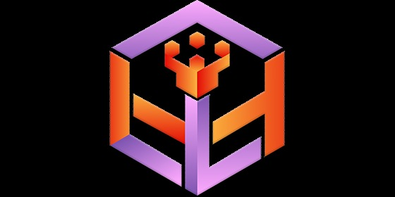
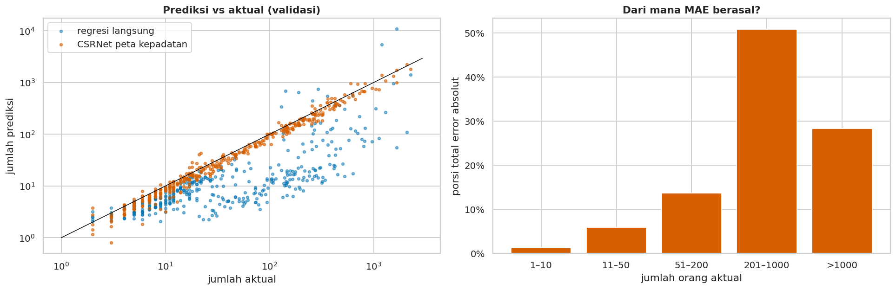
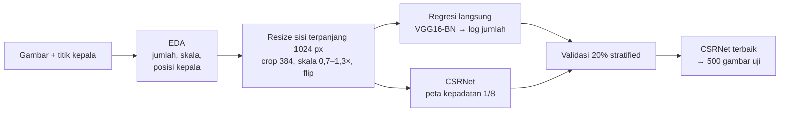
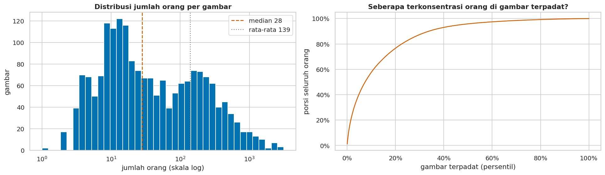
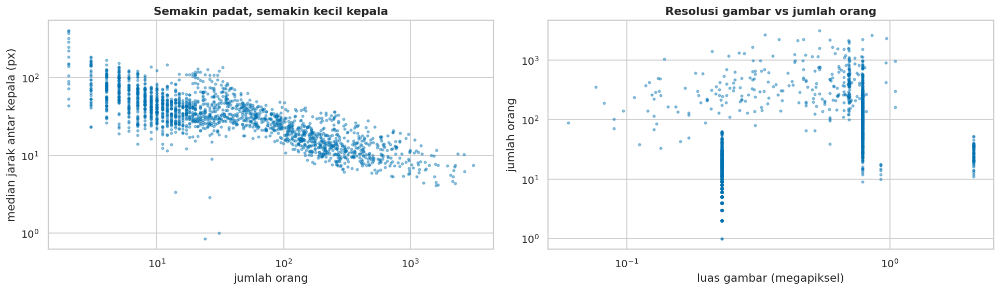
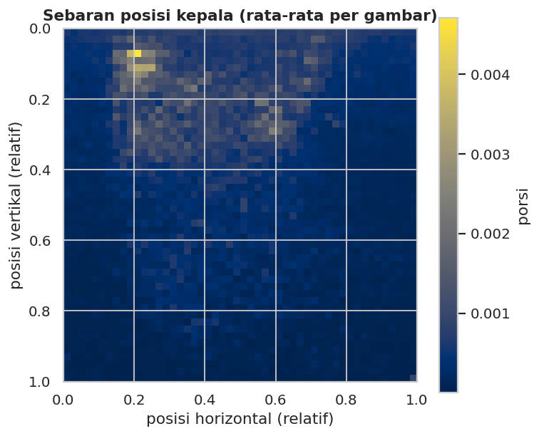
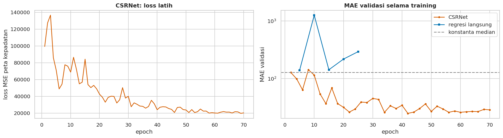
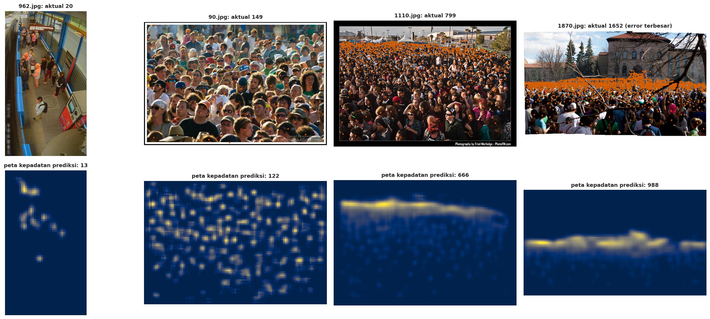

<p align="center">
  
  <br><sub>Gambar: halaman kompetisi <a href="https://www.kaggle.com/competitions/penyisihan-hology-8-0-2025-data-mining">Penyisihan Hology 8.0 2025 Data Mining</a> di Kaggle.</sub>
</p>

# Menghitung Kerumunan dari Satu Foto: Peta Kepadatan vs Regresi Langsung
### Hology 8.0 (Universitas Brawijaya) · Crowd counting 1.900 gambar, metrik MAE

**Jumlah orang dalam satu gambar berkisar dari 1 sampai lebih dari 3.000. Apakah lebih baik model langsung menebak satu
angka, atau belajar di mana setiap orang berada lalu menjumlahkannya?**

Setiap gambar latih dilengkapi koordinat kepala setiap orang. Analisis disusun seperti laporan riset: setiap keputusan
pemodelan berasal dari temuan EDA, dan setiap temuan dibuktikan dengan grafik.

**Temuan utama: dengan backbone yang sama, peta kepadatan CSRNet mencapai MAE validasi 24,9, sedangkan regresi jumlah
langsung 139,4, lebih buruk daripada menebak median (128,0). Late submission mencapai private 21,75, dibanding 39,44 untuk
submission tim saat kompetisi.**



---

## Ruang lingkup

- Eksplorasi distribusi jumlah orang, ragam gambar, skala kepala, dan sebaran posisi kepala.
- Pembentukan target peta kepadatan dari titik kepala.
- Baseline konstanta, regresi jumlah langsung (VGG16-BN), dan CSRNet.
- Analisis error per kelompok kepadatan dan visualisasi peta kepadatan prediksi.

Notebook asli dari masa kompetisi (September 2025) hilang. Seluruh analisis di repositori ini disusun ulang dari nol pada
November 2026 dan dijalankan penuh di Kaggle (GPU Tesla T4, sekitar 80 menit).

## Data dan desain eksperimen

| Data | Isi | Jumlah |
| --- | --- | ---: |
| `train/images`, `train/labels` | gambar dan JSON berisi `human_num` serta koordinat kepala | 1.900 gambar, 263.909 orang |
| `test/images` | gambar yang diprediksi | 500 gambar |

20% gambar latih disisihkan sebagai validasi, stratified berdasarkan kelompok jumlah orang. Semua model dinilai pada
validasi yang sama, dan bobot dengan MAE validasi terbaik dipakai untuk data uji.



## Cerita dari data

### 1. Sedikit gambar menentukan hampir seluruh MAE



Median 28 orang, rata-rata 139, maksimum 3.139. 59% gambar berisi paling banyak 50 orang, tetapi 10% gambar terpadat memuat
58% seluruh orang.

### 2. Skala kepala berubah drastis



Jarak ke kepala terdekat 11–75 px (persentil 10–90), dan makin padat gambarnya makin kecil kepalanya (Spearman −0,80). Gambar
yang lebih besar juga lebih padat (Spearman 0,60), sehingga sisi terpanjang hanya dibatasi 1024 px.

### 3. Kepala berkumpul di bagian atas gambar



79% kepala ada di setengah atas gambar, tempat orang di kejauhan tampak kecil dan rapat.

## Hasil

### Perbandingan model (validasi 380 gambar)

| Model | MAE | RMSE | Error relatif median |
| --- | ---: | ---: | ---: |
| Konstanta: rata-rata | 160,45 | 277,53 | 395% |
| Regresi jumlah langsung (VGG16-BN) | 139,37 | 565,90 | 59% |
| Konstanta: median | 127,99 | 299,12 | 89% |
| CSRNet + flip TTA | 25,09 | 67,98 | 16% |
| **CSRNet peta kepadatan (akhir)** | **24,93** | **66,51** | **16%** |



Regresi langsung sangat tidak stabil (MAE validasi melompat ke 1.257 di epoch 10) dan sistematis meremehkan gambar padat.
CSRNet belajar dari setiap titik kepala, sehingga satu gambar memberi ratusan sinyal latih, dan MAE-nya sudah 98,6 pada
epoch 4. Bobot terbaik ada di epoch 42.

### Di mana error terjadi

| Jumlah orang | Gambar | MAE CSRNet | MAE regresi | Error relatif | Porsi total error |
| --- | ---: | ---: | ---: | ---: | ---: |
| 1–10 | 97 | 1,2 | 2,4 | 17,7% | 1% |
| 11–50 | 129 | 4,3 | 12,8 | 16,8% | 6% |
| 51–200 | 78 | 16,7 | 109,8 | 13,5% | 14% |
| 201–1.000 | 67 | 71,9 | 319,6 | 16,1% | 51% |
| > 1.000 | 9 | 297,8 | 2.343,3 | 16,1% | 28% |

Error relatif CSRNet hampir sama di semua kelompok, jadi MAE besar di gambar padat adalah akibat jumlah orangnya, bukan
kegagalan khusus. Gambar di atas 200 orang hanya 20% validasi, tetapi menyumbang 79% total error.

### Skor kompetisi

| Submission | Public | Private |
| --- | ---: | ---: |
| Notebook ini (late submission, tidak masuk leaderboard resmi) | 24,45 | 21,75 |
| Submission tim dengan private tertinggi, September 2025 (tim AlFaith, peringkat akhir 60 dari 77) | 38,54 | 39,44 |
| Peringkat 1 leaderboard private | | 12,04 |

## Interpretasi



Peta kepadatan menempatkan massa tepat di lokasi kepala, baik untuk belasan orang di halte maupun ratusan orang di konser.
Error terbesar muncul pada foto lapangan dengan ribuan kepala kecil di bagian atas (aktual 1.652, prediksi 988): di
resolusi 1024 px kepala-kepala itu hanya beberapa piksel.

## Menjalankan

Notebook dijalankan di Kaggle (GPU, sekitar 80 menit). Tanpa GPU notebook berjalan dalam mode uji kecil.

```bash
pip install -r requirements.txt kaggle
python _build_notebook.py                  # regenerasi notebook + runner dari satu sumber
kaggle kernels push -p kaggle-notebook     # notebook yang tampil di Kaggle
kaggle kernels push -p kaggle              # runner: mengeksekusi notebook dan menyimpan versi ber-output
kaggle kernels output fauzan2/hology-8-crowd-counting-runner -p output/
```

Data kompetisi tidak disertakan di repositori. Unduh dari halaman kompetisi ke `data/raw/`, lalu jalankan notebook dari
folder `notebooks/`.

## Peta repositori

| Lokasi | Isi |
| --- | --- |
| `notebooks/hology-8-crowd-counting.ipynb` | Notebook riset lengkap dengan output |
| `src/data/dataset.py` | Dataset PyTorch, augmentasi, dan pembentukan peta kepadatan dari titik kepala |
| `src/models/networks.py` | CSRNet dan model regresi jumlah langsung |
| `src/models/train.py` | Loop training, evaluasi, dan prediksi |
| `src/visualization/plots.py` | Gaya grafik dan palet ramah buta warna (Okabe–Ito) |
| `reports/figures/` | 9 grafik yang dipakai di notebook dan README |
| `reports/*.csv` | Hasil validasi, riwayat training, dan error per kelompok |
| `submissions/submission.csv` | Submission akhir |
| `_build_notebook.py`, `_findings.json` | Sumber tunggal notebook dan runner Kaggle, beserta teks temuan |
| `kaggle-notebook/`, `kaggle/` | Metadata kernel notebook dan runner |

## Keterbatasan

Validasi hanya satu split 20%, sehingga MAE validasi berfluktuasi beberapa poin antar epoch. Arsitektur CSRNet (2018) bukan
yang terbaru; P2PNet atau DM-Count, resolusi input lebih tinggi, dan inferensi per potongan gambar kemungkinan menutup
sebagian jarak ke peringkat 1. Skor late submission diperoleh setelah kompetisi berakhir dan tidak dapat dibandingkan
secara setara dengan peserta yang bekerja dalam batas waktu kompetisi.

## Penulis

**Fauzan Ahsanudin Alfikri** · [Kaggle: fauzan2](https://www.kaggle.com/fauzan2)

Data berasal dari kompetisi [Penyisihan Hology 8.0 2025 Data Mining](https://www.kaggle.com/competitions/penyisihan-hology-8-0-2025-data-mining)
(Universitas Brawijaya) dan hanya digunakan untuk keperluan edukasi dan portofolio.
